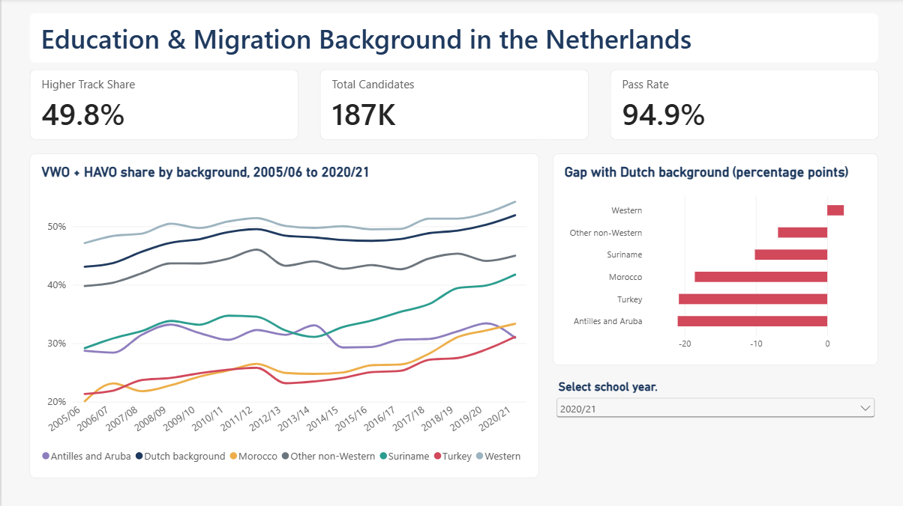
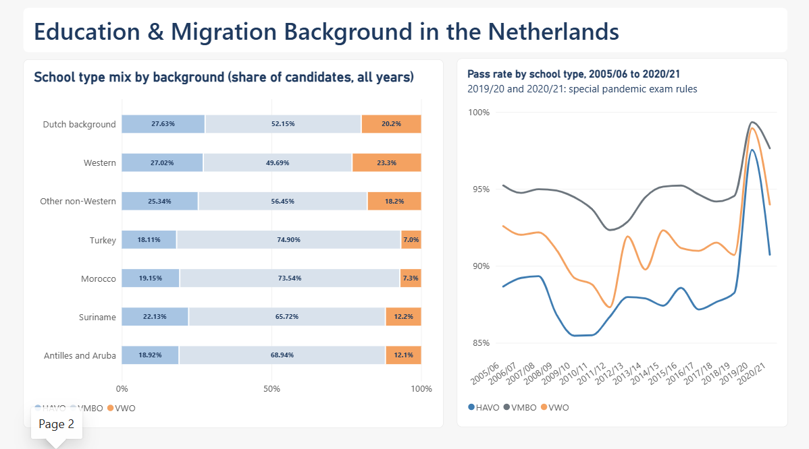

# Education & Migration Background in the Netherlands

How did school placement and exam success differ by migration background from 2005/06 to 2020/21? An end-to-end analysis of real CBS data with SQL, Python and Power BI.



## Key findings

1. **Everyone moved up, but the gap barely closed for some groups.** The share of exam candidates in VWO or HAVO rose for all groups. Compared with Dutch background, the gap narrowed for Morocco (-23.0 to -18.5 points) and Suriname (-13.9 to -10.1). It hardly changed for Turkey (-21.7 to -20.8) and it widened for Antilles and Aruba (-14.4 to -20.9) and Other non-Western (-3.3 to -6.9).
2. **The biggest difference is in VWO, the highest track.** Over all years, 20.2% of candidates with Dutch background were in VWO, against 7.0% for Turkey and 7.3% for Morocco.
3. **Pass rates differ too.** In normal years, the VWO pass rate was about 92% for Dutch background and about 71% for Turkey. In 2019/20 and 2020/21, special pandemic exam rules pushed pass rates up to about 99%, so those years are analysed separately.



## Questions answered

1. How did the VWO + HAVO share change per group, and how fast? (trend per year)
2. How large was the gap with Dutch background each year, and did it narrow?
3. In which school types (VWO, HAVO, VMBO) did the change happen?
4. How do pass rates compare, in normal years and in the pandemic years?
5. Is each group over- or under-represented in each school type? (representation index)

## Tools used

| Tool | Used for |
|---|---|
| Google Sheets | Cleaning the CBS download |
| SQL (SQLite) | Summaries and the first five questions |
| Python (pandas, SciPy) | Trends, gaps, pass rates, representation index |
| Power BI | Interactive dashboard with DAX measures |

## Project structure

```
data/      clean data (432 rows): exam_results_clean.csv
sql/       01_analysis.sql
python/    01_analysis.py
powerbi/   education-migration-dashboard.pbix and screenshots
outputs/   result tables (created when you run the Python script)
```

## How to run

```
pip install -r requirements.txt
python python/01_analysis.py
```

Run the command from the project folder. The script reads `data/exam_results_clean.csv` and writes the result tables to `outputs/`. To open the dashboard, download `powerbi/education-migration-dashboard.pbix` and open it in Power BI Desktop.

## Data

CBS StatLine, table 80122NED (exam candidates and graduates in secondary education by migration background). Netherlands total, all genders. School years 2005/06 to 2020/21. Source: https://opendata.cbs.nl

## Limits

- The figures describe differences between groups. They do not show causes.
- The data cover exam candidates, not all pupils.
- The "total" rows and the very small "Unknown" group are left out of the comparisons.
- 2020/21 figures are provisional, and the CBS table has been discontinued.
- 2019/20 and 2020/21 had special pandemic exam rules.

## About

Remy Rukundo, Rotterdam. Data analytics portfolio project.
